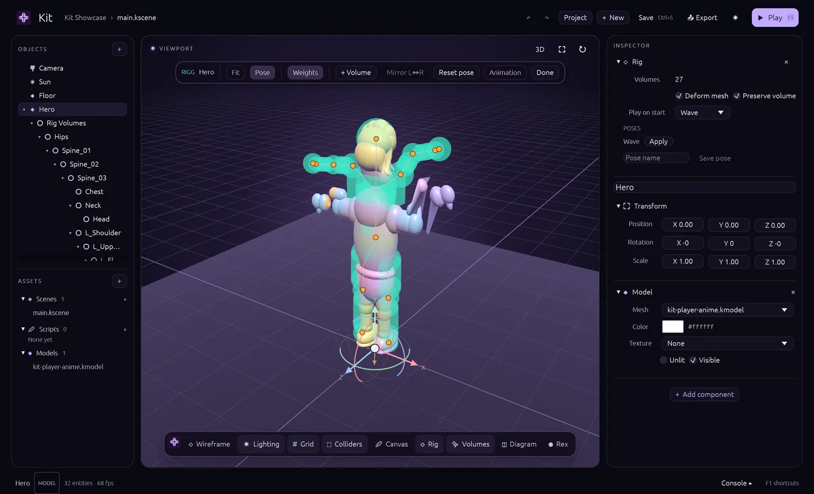
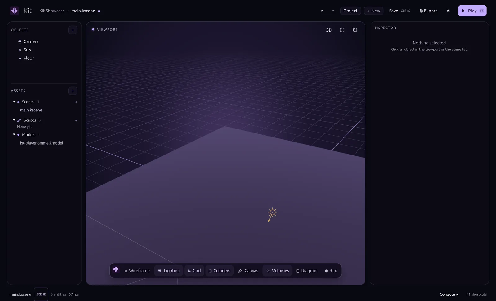
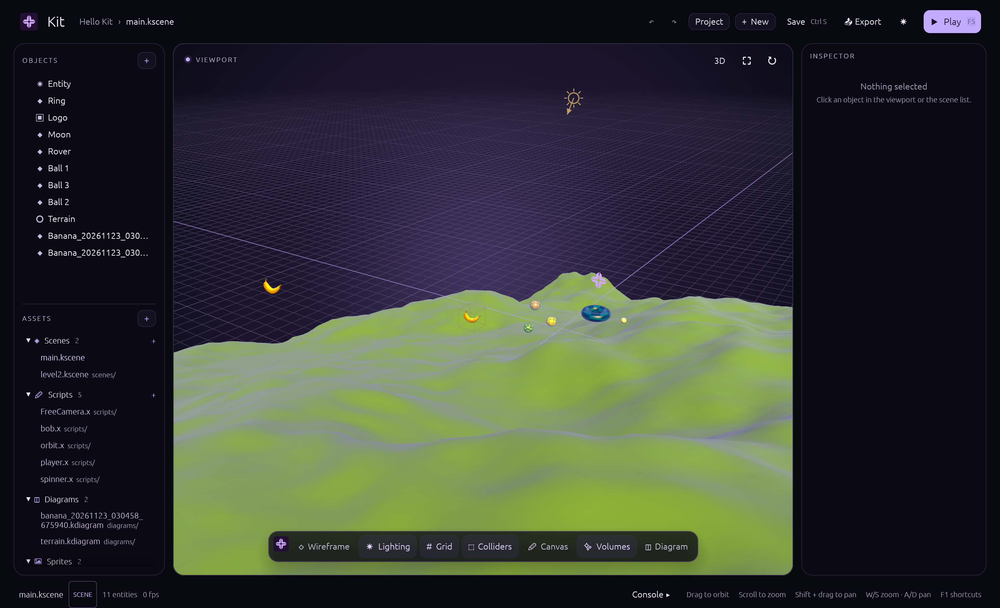

# Changelog

## v0.0.5: Super Multiplayer and Circuits

The easiest multiplayer in game development: install it, tick **Realtime Sync** on your player, and press Play. No game server to write or run.

### Super Multiplayer (new, as a Circuit)
- **Project → Circuit Manager → Multiplayer → Install**, then **Project → Multiplayer…** for your environment and world.
- **+ Add component → Circuits → Realtime Sync** on anything players should share. **One per player** for player characters: each game controls its own and sees everyone else's copy. Shared objects (a ball, a door) belong to whoever got there first, and the next player takes over when they leave.
- **👥 +1 player** next to Play opens another game window that joins the same world.
- **Worlds and rooms:** each scene is a room, a full room opens a new instance automatically (up to 300 players per room by default), and parties stay together.
- **Fast and small:** a moving player is about 22 bytes; nearby players stream at full rate and distant ones less often; in crowds each player sees the closest 64. Rendering, terrain and physics shapes stay local. Physics is best effort: everyone else follows the owner.
- **Seed + diff worlds:** a world seed plus a world hash that changes with each modification. Latecomers rebuild the world locally and fetch only what changed.
- **Shared state** with revisions, presence, and reconnects that keep your objects. Players don't need accounts.
- **Your Kit account → Circuits → Multiplayer:** projects, backend keys, live scopes and state, worlds, usage, diagnostics, settings, billing, and deleting a project.
- **Plans** measured in Sync Time (player time, data and busy rooms): Starter $5, Indie $19, Studio $99, Enterprise by contact. See [pricing](https://login.kitgameengine.win/pricing#multiplayer).

### Circuits (new)
- Installable extensions that connect a project to services: **Project → Circuit Manager** with Available, Installed and Updates tabs, release history, and install, update, downgrade, disable and uninstall.
- Every download is checked before it's unpacked, a failed install changes nothing, and installs never touch your scenes or scripts. `circuits.lock` pins exact versions.
- Circuits can add components and their own Project menu item. Anyone can make one: see `circuit/README.md`.

### Editor
- **Scene View**, between Game View and Preview: the editor's free camera, selection and gizmos, also while the game runs. Play switches to Game View and Stop returns to Scene View.
- **Preview:** look at images, models, sounds, videos and text in the center view without changing the scene.

### Engine
- **`Scene.Load("scenes/level2")`**, `Scene.LoadAdditive`, `Scene.Unload` and `Scene.Current` switch scenes while the game runs. A scene that's missing or broken leaves the current one running.

### Downloads

| Platform | File |
|---|---|
| Mac (Apple Silicon and Intel) | Coming soon: the Mac builds are being signed. Until then, use [v0.0.4 for Mac](https://github.com/caraveo/kit/releases/tag/v0.0.4). |
| Windows 10/11 (x64) | `kit-0.0.5-windows-x86_64.zip` |
| Windows 11 (ARM64) | `kit-0.0.5-windows-arm64.zip` |
| Ubuntu / Debian (x64) | `kit_0.0.5_amd64.deb` |
| Ubuntu / Debian (ARM64) | `kit_0.0.5_arm64.deb` |
| Linux (x64, any distribution) | `kit-0.0.5-linux-x86_64.tar.gz` |
| Linux (ARM64, any distribution) | `kit-0.0.5-linux-aarch64.tar.gz` |

## v0.0.4: Rex and Rigg

Two big additions: **Rex**, an AI companion inside the editor, and **Rigg**, which lets you pose and animate characters with simple shapes, no bones.

### Rex, your AI companion (new)
Press **8** (or **Rex** in the viewport bar). Sign in once with a code shown in the editor; a free Kit account comes with monthly credits.
- **Fetch** writes x gameplay scripts. Kit checks each one with its own parser, and **Add to (object)** saves it and attaches it to the selected object in one click.
- **Dig** builds **Diagrams** (Kit's visual blueprints for game logic). They're validated before use and shown as a summary card; **Use on (object)** attaches the Diagram and opens it in the Diagram view.
- **Sniff** explains errors and helps track down bugs. Errors in the console get an **Ask Rex** button.
- Also: **Buddy** (questions), **Zoomies** (game ideas), **Sit & Learn** (step-by-step lessons).
- **Share scene** gives Rex a summary of your scene, the selected object's script and recent errors, so answers fit your game.

### Rigg: character rigs without bones (new)

- Select a model and press **9** for **Rig mode**. **Humanoid preset** adds about 30 volumes (spheres for joints, capsules for limbs, a box for the chest) fitted to the model.
- **Fit** places volumes without bending the mesh; **Pose** bends the mesh with them. **Weights** colors the mesh by influence. **Mirror L↔R** copies a side.
- **Rig Volume** settings: shape, radius/length/size, influence and falloff. **Preserve volume** keeps limbs from thinning in bends and twists.
- **Poses**: save and apply named poses; **Reset pose** returns to rest.
- **Animation timeline**: clips (Idle, Walk…), keys, auto-key, scrubbing and preview. **Play on start** plays a clip in the game.
- Rigs are saved in the scene and work in every export, including web. Animated models keep their true rest pose when imported, so they can be rigged too.

### Editor
- **Diagrams:** clicking a Diagram in Assets opens it in the Diagram view.
- **Assets:** rename with right-click → **Rename…** or **F2**; scenes, Diagrams and scripts that use the file are updated automatically. The list shows file names only.
- **Views:** Project → View shows or hides each panel, and Default restores the layout. **Rebindable controls** in Project Settings. A **New Project wizard** with six templates.
- **Viewport:** drag to pan, right-drag (or Shift-drag) to orbit; W/S zoom and A/D pan; keys 1–9 toggle the viewport bar and modes.
- Console starts collapsed with a badge for new errors; the inspector scroll bar no longer covers buttons.

### Fixes
- **Mac (Intel):** the v0.0.3 Intel package bundled an Apple Silicon-only MoltenVK, so Kit couldn't start on Intel Macs. Both Mac packages now include Khronos's universal MoltenVK.
- Inspecting a rig volume no longer rounds its values and marks the scene as edited.
- A spinning rigged model no longer re-deforms its mesh every frame.
- Audio tests no longer fail randomly when run in parallel.

### Known limitations
- Scripts and Diagrams can't start or switch rig clips yet; only **Play on start** plays one.
- Rig deformation runs on the CPU; on the web, a character whose pose is changing re-sends its mesh each frame (fine for typical characters, heavy for very dense meshes).
- Rex needs an internet connection and a Kit account.
- The Mac apps aren't notarized: open them the first time with right-click → **Open**.

### Downloads
| System | File |
|---|---|
| Mac (Apple Silicon) | `kit-0.0.4-macos-arm64.dmg` |
| Mac (Intel) | `kit-0.0.4-macos-x86_64.dmg` |
| Windows 10/11 (x64) | `kit-0.0.4-windows-x86_64.zip` |
| Windows 11 (ARM64) | `kit-0.0.4-windows-arm64.zip` |
| Ubuntu / Debian (x64) | `kit_0.0.4_amd64.deb` |
| Ubuntu / Debian (ARM64) | `kit_0.0.4_arm64.deb` |
| Linux (x64, any distribution) | `kit-0.0.4-linux-x86_64.tar.gz` |
| Linux (ARM64, any distribution) | `kit-0.0.4-linux-aarch64.tar.gz` |

Every package includes the editor, the game players for Linux, Windows, Mac and the web, and the Hello Kit example.

## v0.0.3 — Kit logo and editor polish

- Updated the Kit app icon on Ubuntu, macOS, and Windows. The new artwork also appears in the editor header and dock, the welcome screen, and web export loading screens.
- Editor views have clean headers without close buttons.
- Website download buttons open the latest Kit release.

## v0.0.2: Diagrams and Effects

### Major features
- **Diagrams (visual logic):**
  - Blueprint-style graphs that run directly on the engine, with no code generated.
  - Press **7** for the Diagram view: add nodes from a searchable picker, drag wires between typed pins, select a wire and press Del to remove it, set values inline, and undo or redo.
  - **Nodes:**
    - Events: On Start, On Interact, On Trigger Enter/Exit, On Timer, custom events.
    - Objects: position, rotation, scale, Move Over Time, visibility.
    - Appearance and physics: tint, gravity scale, scene gravity, impulse, velocity.
    - Data and logic: datasets, constants, variables, Compare, Branch, Sequence, Delay, math, logic, conversions.
    - Integration: sounds, events, script fields.
  - **Checks:** each problem is flagged on its node and pin before running.
  - **Runtime:** deterministic frame order, a per-frame node budget against runaway loops, and live highlighting and pin values while playing.
  - Runs in the editor, the desktop player and the web player (`kit_diagram`).
- **Game Data:** datasets with typed fields and rows, plus constants, saved in `game.kdata` and referenced by stable IDs (`kit_gamedata`).
- **Effects (post-processing volumes):**
  - Box or sphere volumes with bloom, color grading, exposure, fog, depth of field, vignette, sharpening and more.
  - Each volume affects the camera inside it or the objects inside it. Overlapping volumes blend by priority and soft edges.
  - Identical on Vulkan and WebGPU, with a Volumes preview (**6**) and the `examples/volumes` project (`kit_post`).
- **Protected exports:**
  - Standard, Signed, or Signed + Encrypted.
  - Uses Ed25519 signatures and XChaCha20-Poly1305 encryption, and a pinned publisher key in each player.
  - A changed or re-signed game refuses to start (`kit_export_security`).

### x scripting
- Fields are private by default. `PUBLIC` shows a field in the inspector (read-only) and `EDIT` makes it editable per object; edited values are saved in the scene and applied before `Init`.
- Diagrams read `PUBLIC` fields and set `EDIT` fields.

### Editor
- **Shortcuts:**
  - <kbd>1</kbd>–<kbd>7</kbd> toggle the viewport bar: wireframe, lighting, grid, colliders, canvas, volumes, diagram.
  - <kbd>W</kbd>/<kbd>S</kbd> zoom, and <kbd>A</kbd>/<kbd>D</kbd> pan (<kbd>Q</kbd>/<kbd>E</kbd> down/up, <kbd>Shift</kbd> faster).
- **Import files…** and drag-and-drop for every kind of file Kit uses: sounds, sprites, 3D models, scripts, scenes and diagrams. Sprites and sounds dropped on the viewport become objects.
- **Export:**
  - Exports go to `~/KitBuilds/<project>/<platform>` by default.
  - Exports are written atomically.
  - A stale player is detected and rebuilt.
- **Inspector and console:**
  - The console starts collapsed, with a badge for new errors.
  - The inspector scroll bar appears after a short delay and no longer covers buttons.
- New app icon.

### Bug fixes
- The asset list no longer shows copies from exported games inside the project (Scenes showed 6 instead of 2).
- Long model names no longer overflow the inspector and object list.
- Fixed hierarchy drag-to-reparent, which could swallow other drags.
- Light mode now uses a light viewport background and no longer shows a stray dark line between panels.
- Exports no longer include the export folder itself.
- Mac exports made on Linux now include MoltenVK.

## v0.0.1 — first release

The first public build of Kit: a modular 2D/3D game engine in Rust with a
Vulkan renderer, an editor, and the **x** scripting language.

### Engine modules
- **kit_ecs**: generational entities, sparse-set component storage, resources, tuple queries.
- **kit_core**: `App`, the `Module` trait, ordered stages, play/edit run modes, time, console.
- **kit_scene**: scene graph with transforms, parent/child hierarchy and transform propagation.
- **kit_input**: keyboard and mouse state with pressed/released edges and axes.
- **kit_resource**: `kit.project` files, resource paths, text and image loading.
- **kit_gamesys**: Camera (perspective or 2D orthographic), Model (built-in meshes), Sprite, Light and Script components, plus `.kscene` scene files.
- **kit_graphics**: Vulkan 1.3 (dynamic rendering), swapchain, GPU memory, and WGSL shaders compiled at runtime.
- **kit_render**: lit 3D models, alpha-blended 2D sprites, 4× MSAA, textures with hot reload, the editor grid and gradient backdrop, and picking.
- **kit_x**: the x language, with a lexer, parser and interpreter. It supports classes, `RIDE` inheritance, methods, strict types, `GRAB`/`LOOP`/`IF`, multiple returns, `TAKE` for modules and other files, and a built-in `Math` module.
- **kit_script**: x scripts on entities with `Init`/`Update`/`Final` and collision hooks, script hot reload, and the `Transform`, `Input`, `Time`, `Entity`, `Scene`, `Sprite`, `Model`, `Physics`, `Path`, `Terrain`, `Audio` and `Log` modules.
- **kit_audio**: Audio Source components and script sounds (WAV, MP3, Ogg Vorbis, FLAC, AAC). 3D sounds fade with distance (Natural, Linear or Smooth falloff) and pan left/right. On Linux it uses the system's sound with no extra packages.
- **kit_collider**: collision shapes (box, sphere, capsule, cylinder), contact and trigger events, ray casts. Built on Rapier.
- **kit_physics**: rigid bodies (dynamic, kinematic, static), gravity, mass, damping, forces and impulses, 2D plane lock, CCD.
- **kit_path**: follows paths sketched in Canvas mode, best effort, respecting colliders and physics.
- **Terrain** (in kit_gamesys/kit_render/kit_collider): height grids with generation, sculpting, slope/height coloring and heightfield colliders.
- **kit_engine**: the windowed runtime.
- **Imported 3D models**: OBJ, glTF/GLB, FBX, USDZ and STL (converted with Blender), with materials, textures and animation clips.

### Tools
- **kit-editor**: terrain sculpting, camera/light gizmos with a live camera preview, glide-to-frame on hierarchy select, Canvas mode for sketching movement paths, collider outlines, Collider/Rigid Body/Path inspectors, hierarchy with drag-and-drop reparenting, inspector, Vulkan viewport (orbit, pan, zoom, 2D/3D, wireframe, lighting, grid), click to select, undo/redo, play mode with live script fields, console, x code editor with syntax highlighting, asset list, new/open project, and an export command that writes a runnable game folder.
- **kit-editor**, newer features: move arrows and rotation rings, sound drag-and-drop (Assets → Sounds), 3D model import, light and dark themes, and the **Export wizard**.
- **Export wizard and Hooks**: each platform is a hook (`hooks/<platform>`). Kit exports Linux, Windows, Mac and **Web** builds. The web build runs in the browser on WebGPU, with the same engine, shaders and mixer as desktop. Licensed platforms (Switch, PlayStation, Xbox, Steam) show **Request access**, and installed hooks can add exporters.
- **kit-player**: runs a project or an exported game. Every Kit package includes the Linux, Windows, Mac and web players, so any editor can export for any of them.
- An example project, **Hello Kit**.

### Downloads
| System | File |
|---|---|
| Mac (Apple Silicon) | `kit-0.0.1-macos-arm64.dmg` |
| Mac (Intel) | `kit-0.0.1-macos-x86_64.dmg` |
| Windows 10/11 (x64) | `kit-0.0.1-windows-x86_64.zip` |
| Ubuntu / Debian (x64) | `kit_0.0.1_amd64.deb` (`sudo apt install ./kit_0.0.1_amd64.deb`) |
| Linux (x64, any distribution) | `kit-0.0.1-linux-x86_64.tar.gz` |

Kit needs a GPU with Vulkan 1.3 (on Macs, MoltenVK is included). The Mac apps aren't notarized, so open them the first time with right-click → **Open**.
