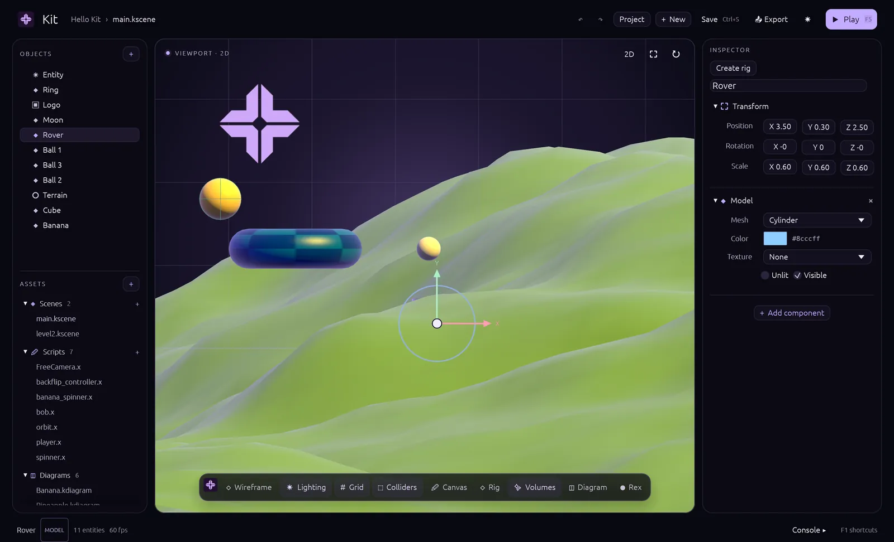
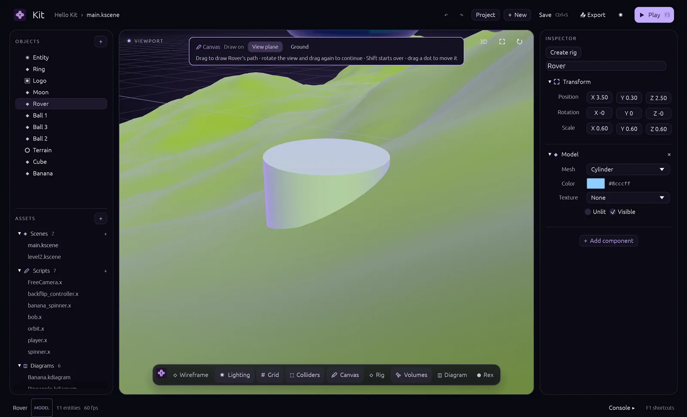
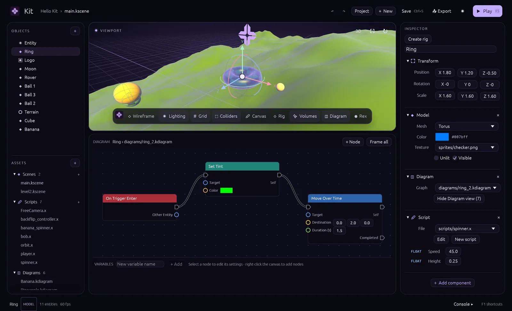
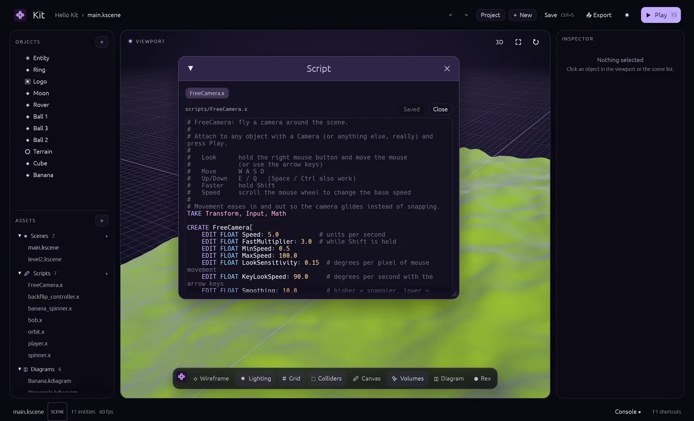
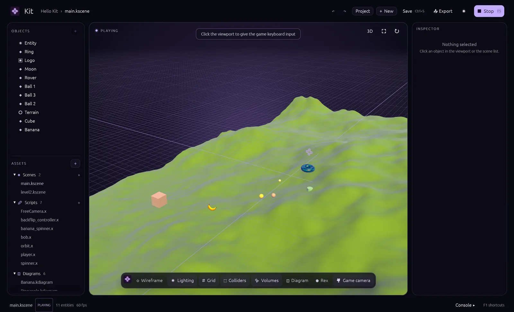
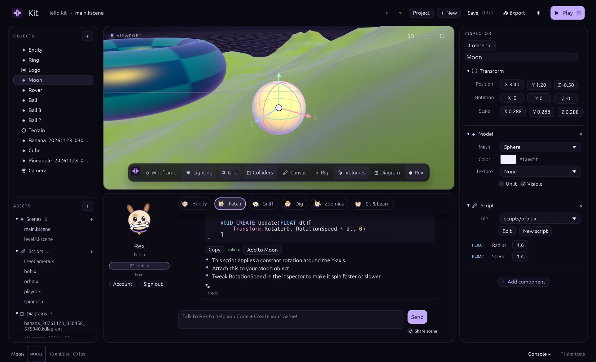
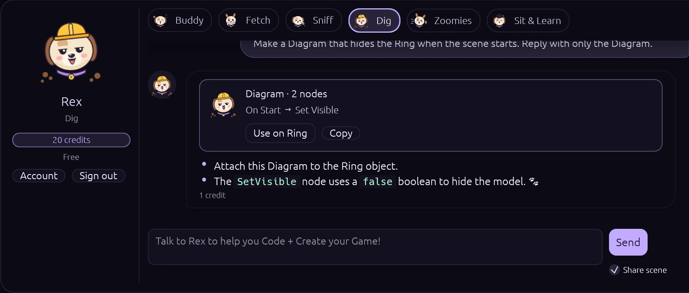
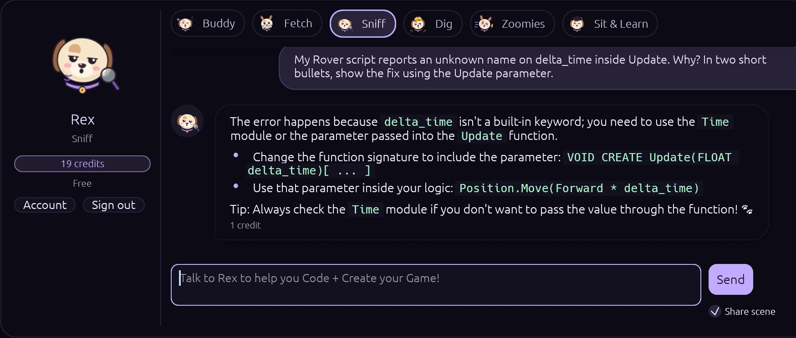
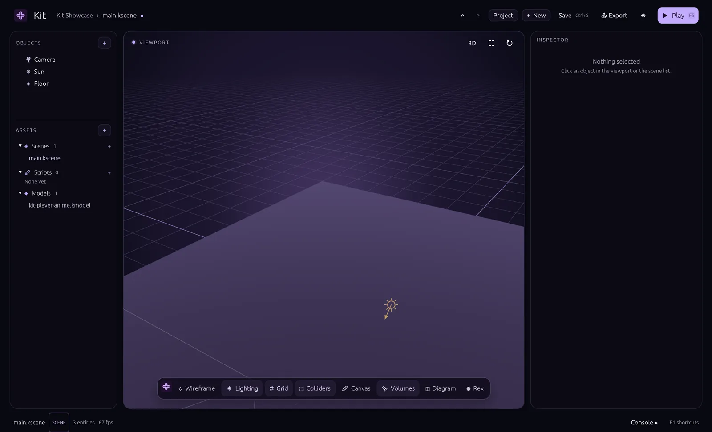

[](https://kitgameengine.win)

# Kit

**Draw a path. Press play. See where it goes.**

Kit is a free, open-source **2D and 3D game engine** with its own editor. You build scenes, give objects behavior with visual **Diagrams** or the **x** scripting language, press **F5** to play in the same window, and export your game for desktop or the web. **Rex**, the built-in AI companion, can write scripts and Diagrams for you, **Rigg** lets you pose and animate characters without bones, and **Super Multiplayer** puts players in the same world with a checkbox: no servers to write or run.

Kit runs on **Linux, Windows and macOS** and is written in Rust (Vulkan on desktop, WebGPU in the browser). It's MIT-licensed, so you can make and sell games with no royalties.

[](https://github.com/caraveo/kit/actions/workflows/ci.yml) [](https://github.com/caraveo/kit/actions/workflows/release.yml) [](https://github.com/caraveo/kit/actions/workflows/circuit-release.yml) [](https://github.com/caraveo/kit/releases/latest)

**[⬇ Download Kit v0.0.5](https://github.com/caraveo/kit/releases/latest)** · [Website](https://kitgameengine.win) · [Docs](documentation/src/content/docs) · [Changelog](CHANGELOG.md) · [Report a problem](https://github.com/caraveo/kit/issues)



---

## Contents

- [What you can do](#what-you-can-do)
- [Requirements](#requirements)
- [Install](#install)
- [Your first five minutes](#your-first-five-minutes)
- [Rex, the AI companion](#rex-the-ai-companion)
- [Rigg: character animation without bones](#rigg-character-animation-without-bones)
- [Super Multiplayer](#super-multiplayer)
- [Circuits: extensions for your project](#circuits-extensions-for-your-project)
- [Scripting in x](#scripting-in-x)
- [Export and share your game](#export-and-share-your-game)
- [Keyboard shortcuts](#keyboard-shortcuts)
- [Troubleshooting](#troubleshooting)
- [Build from source](#build-from-source)
- [Project layout](#project-layout)
- [License](#license)

---

## What you can do

| | |
|---|---|
| **Draw movement.** Select an object, press **5** for Canvas mode and sketch its path in the viewport. Press play and it follows the path, bumping into colliders and physics objects on the way. |  |
| **Add logic without code.** Press **7** for the Diagram view. Wire events (On Start, On Trigger Enter, On Interact, On Timer…) to actions (move, tint, show/hide, play a sound, change gravity…). Diagrams light up live while the game runs. |  |
| **Write gameplay in x.** A small, readable scripting language with a built-in code editor. `EDIT` fields show up in the inspector so you can tune each object. |  |
| **Play instantly.** **F5** runs the game inside the editor, in the **Game View**. Switch to **Scene View** while it runs to fly around freely. Click the viewport to give the game your keyboard, and press **Esc** to get it back. |  |

Plus:

- **Bring your own art.** Sprites, sounds, and 3D models (GLB, glTF, FBX, OBJ, USDZ, STL) with colors, textures and animations. Use **Assets → + → Import files…** or drag files onto Kit.
- **Physics** (Rapier): rigid bodies, colliders and triggers, all set up in the inspector.
- **Sculptable terrain**, lights, cameras, and **positional sound**.
- **Particle Emitters** (+ Add component): continuous streams and bursts, with direction, spread, speed, gravity, size, color and an optional texture. They preview live in the editor.
- **Effects:** post-processing volumes for bloom, color grading, fog, depth of field, vignette and more.
- **Game Data:** datasets and constants your Diagrams can read.
- **Fabs:** right-click an object → **Save as Fab** to reuse it anywhere: place it from **Assets → Fabs** or spawn it from a script.
- **Six project templates** in the New Project wizard, plus the **Hello Kit** example that comes with every download.

---

## Requirements

| | Minimum |
|---|---|
| **Operating system** | 64-bit Linux, Windows 10/11, or macOS 12+ (Apple Silicon or Intel) |
| **Graphics** | A GPU with **Vulkan 1.3** and current drivers. Most GPUs from 2016 onward work. On Mac, Vulkan runs through MoltenVK, which is bundled with Kit. |
| **Disk** | About 150 MB, including the example project |
| **Optional: Blender 4.5+** | Only needed to import FBX, glTF/GLB, USDZ and STL models (plain OBJ works without it). Kit finds Blender automatically, or set `KIT_BLENDER` to its path. |
| **Optional: internet + Kit account** | Only for Rex, the AI companion. Everything else works offline. |
| **To play web exports** | A browser with WebGPU: recent Chrome, Edge, Firefox or Safari. |

Not sure your GPU supports Vulkan 1.3? On Linux, run `vulkaninfo --summary` (from the `vulkan-tools` package). On Windows, update your graphics driver from NVIDIA, AMD or Intel.

---

## Install

Get the file for your computer from the **[latest release](https://github.com/caraveo/kit/releases/latest)**:

| Your computer | Download | Then |
|---|---|---|
| Mac (Apple Silicon or Intel) | v0.0.6 is coming soon (being signed). Meanwhile: [`kit-0.0.4-macos-arm64.dmg`](https://github.com/caraveo/kit/releases/download/v0.0.4/kit-0.0.4-macos-arm64.dmg) or [`kit-0.0.4-macos-x86_64.dmg`](https://github.com/caraveo/kit/releases/download/v0.0.4/kit-0.0.4-macos-x86_64.dmg) | Open it and drag **Kit** into **Applications**. |
| Windows 10/11 (most PCs) | `kit-0.0.6-windows-x86_64.zip` | Right-click → **Extract All**, then run **kit-editor.exe**. |
| Windows 11 on ARM | `kit-0.0.6-windows-arm64.zip` | Same as above. |
| Ubuntu / Debian | `kit_0.0.6_amd64.deb` (or `_arm64.deb`) | `sudo apt install ./kit_0.0.6_amd64.deb`, then open **Kit** from your apps. |
| Other Linux | `kit-0.0.6-linux-x86_64.tar.gz` (or `-aarch64`) | `tar -xzf kit-0.0.6-linux-x86_64.tar.gz && cd kit-0.0.6-linux-x86_64 && ./kit-editor` |

Not sure which Mac you have? Apple menu → **About This Mac**: "Chip: Apple M…" means Apple Silicon, "Processor: Intel…" means Intel.

Each download includes the editor (`kit-editor`), the game player (`kit-player`), the players used for exporting to every platform, and the Hello Kit example. Checksums are in `SHA256SUMS` on the release page.

### First launch on a Mac

Kit isn't notarized by Apple yet, so macOS blocks it the first time:

1. Open **Kit** from Applications. macOS says it can't verify the developer. Click **Done**.
2. Go to **System Settings → Privacy & Security**, scroll down and click **Open Anyway** next to Kit.
3. Confirm with your password. After that, Kit opens normally.

### First launch on Windows

If your release offers a Windows `-setup.exe`, run it and open **Kit Editor** from the Start menu. Setup installs the Microsoft Visual C++ runtime automatically.

The x64 installer also includes a Vulkan runtime and a CPU-based Vulkan driver. Setup offers **Reinstall** or **Skip** when the Vulkan runtime is already installed. For a VM or a machine without a Vulkan-capable GPU, open **Kit Editor (Software Vulkan)** from the Start menu.

If you use the portable ZIP, extract the entire folder and install the Microsoft Visual C++ Redistributable for your Kit build before opening `kit-editor.exe`. [x64 download](https://aka.ms/vc14/vc_redist.x64.exe) · [ARM64 download](https://aka.ms/vc14/vc_redist.arm64.exe)

Windows SmartScreen may say "Windows protected your PC". Click **More info → Run anyway**.

---

## Your first five minutes

1. **Open Kit** and choose **Open example**. That opens *Hello Kit*, a small 3D scene with terrain, a rover and some props. Or choose **New project…** and pick a template.
2. **Look around.** Right-drag (or Shift-drag) to orbit, drag to pan, and scroll or **W**/**S** to zoom. Press **F** to frame the selected object.
3. **Select something.** Click an object in the viewport or in **Objects** on the left. Change its position, color or mesh in the **Inspector** on the right.
4. **Draw a path.** With the object selected, press **5** (Canvas), drag in the viewport to sketch where it should go, then press **5** again.
5. **Add logic.** Press **7** (Diagram) → **+ Add Diagram**. Right-click the canvas to add an event like *On Start* and an action like *Set Tint*, then drag a wire between them.
6. **Play.** Press **F5**. Click the viewport so the game gets your keyboard. Press **F5** again to stop. Nothing you change while playing is saved.
7. **Save** with **Ctrl+S** (**⌘S** on Mac).

The full walkthrough is in [Make your first game](documentation/src/content/docs/getting-started/first-game.mdx).

---

## Rex, the AI companion

Rex is a friendly AI puppy that lives in the editor and helps you build your game. Press **8** (or click **Rex** in the viewport bar) and type what you want.

| Mode | What it does |
|---|---|
| **Fetch** | Writes an x script. Kit checks it, then **Add to (object)** saves it and attaches it in one click. |
| **Dig** | Builds a Diagram. **Use on (object)** attaches it and opens it in the Diagram view. |
| **Sniff** | Explains errors and helps you fix bugs. Errors in the console get an **Ask Rex** button. |
| **Buddy** · **Zoomies** · **Sit & Learn** | Answers questions, brainstorms game ideas, and teaches step by step. |



<table><tr>
<td></td>
<td></td>
</tr></table>

**To use Rex:**

1. Open Rex (**8**) and click **Sign in**. Your browser opens [login.kitgameengine.win](https://login.kitgameengine.win). Sign in with email or GitHub and enter the code Kit shows you.
2. Free accounts get **30 credits a month**. Most questions cost 1 credit. Paid plans and top-ups are on the [pricing page](https://login.kitgameengine.win/pricing).
3. Leave **Share scene** on so Rex knows your objects, the selected object's script and recent errors.

Rex needs an internet connection. The rest of Kit works fully offline, and Kit never sends your project anywhere unless you ask Rex something. [Rex guide](documentation/src/content/docs/editor/rex.md)

---

## Rigg: character animation without bones

Rigg rigs a 3D character with simple shapes (spheres, capsules and boxes) instead of a skeleton. Move a shape and the mesh around it bends with it.



1. Import a character model and select it, then press **9** for **Rig mode**.
2. Click **Humanoid preset**. About 30 volumes are fitted inside the body.
3. Use **Fit** to adjust volumes without bending the mesh, and **Weights** to see what each one moves.
4. Switch to **Pose** and rotate volumes to pose the character. **Mirror L↔R** copies one side to the other.
5. Click **Animation**, create a clip (Idle, Walk…), move the playhead and press **◆ Key**. Set **Play on start** in the inspector to play a clip when the game starts.

Rigs work in every export, including the web. [Rigg guide](documentation/src/content/docs/editor/rigg.md)

---

## Super Multiplayer

The easiest multiplayer in game development: no game server to write, rent or run. Clients render and simulate, and Kit's Realtime service syncs only what other players need to see.

1. **Project → Circuit Manager** → **Multiplayer** → **Install**.
2. Choose a plan on your Kit account (**Circuits → Multiplayer → Billing**) and create a project there. Copy its environment id and turn on anonymous play in **Settings**.
3. **Project → Multiplayer…** → paste the environment id.
4. Select your player → **+ Add component → Circuits → Realtime Sync** → tick **One per player**. Add Realtime Sync without that box to shared objects (a ball, a door). **Save**.
5. Press **Play**, then **👥 +1 player** to open more game windows. Switch to **Scene View** to watch everyone.

How it works:

- **Worlds, scenes and rooms.** Each game has a world, and every scene is a room (a *sector*). A full room opens a new instance automatically, and parties stay together. `Scene.Load("scenes/level2")` moves the player to that scene's room.
- **Only what changes travels.** A moving player costs about 22 bytes. Rendering, terrain and physics shapes stay local. Each player gets the nearby players at full rate, distant ones less often, and only the closest 64 in a crowd (up to 300 per room).
- **Seed + diff worlds.** A world's seed and a world hash that changes with every modification. Latecomers regenerate the world locally and fetch only the changes for the chunks they're near.
- **Shared state** with revisions (scores, timers, weather, quest flags), presence, and reconnects that keep your objects.
- **Physics is best effort.** The owner simulates and everyone else follows its transform ([networked-physics.md](circuit/multiplayer/networked-physics.md)).
- **Players never need accounts.** Games get short-lived connection tokens, anonymously or from your own backend with a backend key.

**Pricing** is measured in **Sync Time**, and every account gets **10 sync-hours a month free** to build and playtest. One sync-hour is one player connected for an hour, including 10 MB of data. Extra data counts too, and a busy room counts as at least 4 players. Plans: Starter $5 (600 sync-hours), Indie $19 (4,000 included, then $0.006 per sync-hour), Studio $99 (20,000 included, then $0.005), and Enterprise (rex@kitgameengine.win). Need more? **Buy Time:** sync-hour packs (500 for $5, 2,500 for $20, 10,000 for $60) never expire and are used before any overage. See [login.kitgameengine.win/pricing](https://login.kitgameengine.win/pricing#multiplayer). Without a plan, games pause when the free hours and any packs run out, until next month.

Details: [circuit/multiplayer](circuit/multiplayer) (README, [binary protocol](circuit/multiplayer/PROTOCOL.md), [AI NPC notes](circuit/multiplayer/ai-npc.md)).

---

## Circuits: extensions for your project

Circuits are installable extensions that connect Kit to services, such as Multiplayer. They aren't built into the engine: each project chooses its own Circuits and versions.

- **Project → Circuit Manager:** browse, install, update, downgrade, disable and remove. You sign in with your Kit account.
- **Safe:** downloads are checked (SHA-256, plus publisher signatures when signed) before anything is unpacked. An install never touches your scenes or scripts, and a failed one changes nothing.
- **Reproducible:** `circuits.lock` records exact versions and checksums, so commit it with your project. Settings live in `circuits.settings.toml`.
- Circuits can add **components** (under **+ Add component → Circuits**) and their own item in the **Project** menu.
- **Make your own:** see [circuit/README.md](circuit/README.md) for the `circuit.toml` format, packaging with `kit-circuit`, and publishing.

Kit's own Circuits:

- **Multiplayer:** serverless realtime multiplayer (see [Super Multiplayer](#super-multiplayer)).
- **Cinematics:** camera shots for intros, cutscenes and trailers. Put a **Cinematic** on an Empty and a **Cinematic Shot** on each camera inside it. You get cuts and blends, camera moves drawn in Canvas, look-at, zoom, shake, captions, letterbox, fades and a skip key. Start one on load, with `Cinematic.Play("Intro")`, or from a diagram. [Guide](circuit/cinematics/README.md)

**Try it:** open Hello Kit, then **Assets → Scenes → demo**, and press **F5**. *Crystal Run* opens with a Cinematics intro, then you fly through a procedural asteroid field collecting crystals against the clock.

---

## Scripting in x

x is Kit's scripting language: uppercase keywords, square brackets for blocks, and engine modules you `TAKE`. Attach a script to an object with **Add component → Script**.

```x
TAKE Transform, Input

CREATE Player[
    EDIT FLOAT Speed: 3.0      # editable per object in the inspector
    PUBLIC INTEGER Coins: 0    # shown in the inspector, read-only

    VOID CREATE Update(FLOAT dt)[
        FLOAT X: Input.Axis("Left", "Right")
        Transform.Move(X * Speed * dt, 0, 0)
    ]
]
```

Fields are private unless marked `PUBLIC` or `EDIT`, and Diagrams can read `PUBLIC` fields and set `EDIT` fields.

Scripts can reach other objects and the rest of the engine:

```x
TAKE Scene, Time, Transform
CREATE Turret[
    VOID CREATE Init()[
        Time.Every(1.5, "Fire")                      # timers
    ]
    VOID CREATE Fire()[
        ANY Shot: INSTANTIATE("Bullet", Transform.Position)   # spawn a Fab or a copy
        Enemy E: GetFeature(Scene.Find("Goblin"), "Enemy")    # another object's script
        E.TakeDamage(10)
    ]
    VOID CREATE OnClick()[
        Time.Start("Overheat")                       # a coroutine
    ]
    VOID CREATE Overheat()[
        BeActive(FALSE)
        WAIT 3                                       # pause here for 3 seconds
        BeActive(TRUE)
    ]
]
```

- **Spawning:** `INVOKE` (inside this object) and `INSTANTIATE` (top level) create shapes, models, Fabs or copies.
- **Features:** `GetFeature`, `AddFeature`, `RemoveFeature`, `HasFeature`, `BeActive` and `.Enabled` work on scripts and on engine parts (Model, Physics, Audio, Light, Camera…) of any object.
- **Lifecycle:** `Init`, `Update`, `FixedUpdate`, `LateUpdate`, `OnCollision(other, hit)`, `OnTrigger`, `OnClick`, `Final`.
- **Time:** `Time.After`, `Time.Every`, and coroutines with `Time.Start` and `WAIT`.
- **Math:** `Rotation.Blend`, `LookToward`, `TurnToward` and more, plus `Math.Blend`, `MoveToward`, `Smooth`, `Noise`.
- **Physics:** collision point, normal and strength, `Physics.FindNear`, `SweepSphere`, layers, switching body kinds.
- **And:** animation control (`Model.Play`), live sound volume and pitch, cameras and `ScreenToRay`, mouse lock, input actions you can rebind, touch, tags, saving (`Save.Set` / `Save.Get`) and debug lines.
- **Diagrams and scripts talk both ways:** a **Run Script** node calls a script function and gets its result; `Diagram.Emit` sends events to diagrams.

[Learn x](docs/x.md) · [Features, timers and more](documentation/src/content/docs/scripting/features.md) · [Scripting recipes](documentation/src/content/docs/scripting/recipes.md)

---

## Export and share your game

Click **Export** in the top bar and pick a platform:

- **Linux, Windows, Mac:** a folder with the player and your game, ready to zip and share. You can export for any desktop platform from any desktop platform.
- **Web (HTML5):** a folder you can upload to any static host (itch.io, GitHub Pages, your own website…). Players need a WebGPU browser.
- **Protection:** *Signed* makes the player run only the build you published, and *Signed + Encrypted* also hides your files.

[Export guide](documentation/src/content/docs/editor/export.md)

---

## Keyboard shortcuts

Press **F1** in Kit to see them all, or change any of them in **Project → Project Settings → Controls**. On Mac, use **⌘** instead of **Ctrl**.

| Key | Action | | Key | Action |
|---|---|---|---|---|
| **F5** | Play / stop | | **1** | Wireframe |
| **Ctrl+S** | Save | | **2** | Lighting |
| **Ctrl+Z** / **Ctrl+Shift+Z** | Undo / redo | | **3** | Grid |
| **Ctrl+D** | Duplicate | | **4** | Collider outlines |
| **Delete** / **Backspace** | Delete selection | | **5** | Canvas (draw paths) |
| **F2** | Rename | | **6** | Effects preview |
| **F** | Frame selection | | **7** | Diagram view |
| **W** / **S** | Zoom in / out | | **8** | Rex |
| **A** / **D** | Pan left / right | | **9** | Rig mode |
| **Q** / **E** | Camera down / up | | **T** | Switch 2D / 3D |
| **Esc** | Release game input / leave Canvas | | **`** | Console |

Panels can be hidden from **Project → View**. **Default** restores the layout.

---

## Troubleshooting

**Kit closes right away or says Vulkan isn't available.** Update your graphics driver. On Linux, install Mesa's Vulkan drivers (`sudo apt install mesa-vulkan-drivers`) or the NVIDIA driver, then check `vulkaninfo --summary` shows a Vulkan 1.3 device. Virtual machines and very old GPUs usually don't support Vulkan 1.3.

**macOS says Kit "can't be opened" or "is damaged".** See [First launch on a Mac](#first-launch-on-a-mac). If it still says "damaged", run `xattr -dr com.apple.quarantine /Applications/Kit.app` in Terminal.

**A model won't import.** FBX, glTF/GLB, USDZ and STL need [Blender 4.5 or newer](https://www.blender.org/download/). If Blender is installed somewhere unusual, set `KIT_BLENDER` to its executable.

**The game ignores my keyboard.** Click inside the viewport while playing. **Esc** gives the keyboard back to the editor.

**An exported web game shows a "WebGPU" message.** Open it in a recent Chrome, Edge, Firefox or Safari. Web games also have to be served over `http(s)://`, not opened as a file. For a quick local test, run `python3 -m http.server` in the export folder.

**Rex says I'm out of credits.** Free credits refill monthly. You can see your balance under Rex's avatar, and buy more on the [pricing page](https://login.kitgameengine.win/pricing).

Still stuck? [Open an issue](https://github.com/caraveo/kit/issues) with your OS, GPU and what you saw. The **Console** (**`**) usually has the exact error.

---

## Build from source

You need [Rust](https://rustup.rs) 1.85 or newer and Vulkan development files.

| Platform | Install first |
|---|---|
| Ubuntu / Debian | `sudo apt install build-essential pkg-config libvulkan-dev libxkbcommon-dev libwayland-dev` |
| Fedora | `sudo dnf install gcc pkgconf vulkan-loader-devel libxkbcommon-devel wayland-devel` |
| macOS | Xcode Command Line Tools (`xcode-select --install`) and `brew install molten-vk` |
| Windows | [Visual Studio Build Tools](https://visualstudio.microsoft.com/visual-cpp-build-tools/) with "Desktop development with C++" |

```sh
git clone https://github.com/caraveo/kit
cd kit
cargo run --release --locked -p kit-editor -- examples/hello   # the editor
cargo run --release --locked -p kit-player -- examples/hello   # just the game
cargo test --workspace --locked                                 # all tests
```

Set `KIT_VALIDATION=1` to turn on the Vulkan validation layers while developing.

**Packaging:** after `cargo build --release`, run `packaging/linux/package.sh` (`.tar.gz` + `.deb`), `packaging/macos/package.sh` (`.dmg`), or `pwsh packaging/windows/package.ps1` (`.zip`). On Windows, add `-Installer` with Inno Setup 6.3 or newer installed to also build a setup EXE. Pushing a `v*` tag runs [the release workflow](.github/workflows/release.yml), which builds the packages and publishes a GitHub release.

**Docs site:** `cd documentation && npm install && npm run dev`, then open http://localhost:4321.

More detail: [Build from source](documentation/src/content/docs/engine/build-from-source.md) · [Architecture](documentation/src/content/docs/engine/architecture.md)

---

## Project layout

| Folder | What's in it |
|---|---|
| `editor/` | The Kit editor (egui) |
| `player/` | `kit-player`, the standalone game runner |
| `kit/` | The engine crate games and tools build on |
| `modules/` | Engine modules: rendering (Vulkan), physics, audio, scripting (x), Diagrams, Rigg, Rex client, Circuits, and more |
| `circuit/` | Circuits: the format and Kit's own (`circuit/multiplayer`: SDK, game runtime, protocol docs) |
| `web/` | The WebGPU web player (`kit_web.wasm` + `kit.js`) |
| `examples/hello/` | The Hello Kit example project |
| `documentation/` | The documentation site (Astro Starlight) |
| `packaging/` | Scripts that build the release packages |
| `site/` | The kitgameengine.win website |

---

## License

Kit's engine, editor and runtime are free under the [MIT License](LICENSE). You can make and sell games with Kit with no royalties. When you distribute a game that includes the Kit runtime, include the Kit license notice.

The [Kit name and logo](BRANDING.md) are reserved. Separately sold educational products have their own terms.

Building something with Kit? [Open an issue](https://github.com/caraveo/kit/issues) to show what you're making, report a rough edge, or tell us what would help you finish it.
