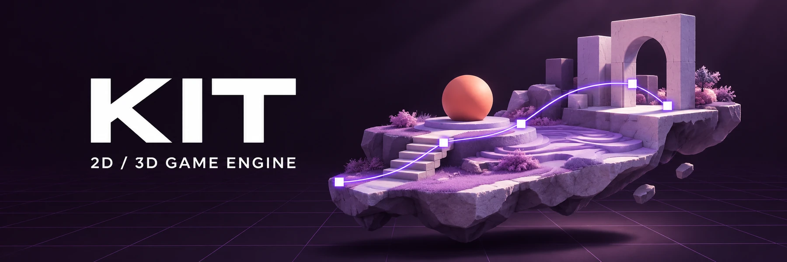

[](https://github.com/caraveo/kit)

# Kit

**Draw a path. Press play. See where it goes.**

Kit is a 2D and 3D game engine for making playable prototypes and building on them. Sketch movement directly in the viewport, bring your own sprites and 3D models, and press **F5** to try the result in the same window. When you're ready to share, export a desktop build or a browser build.

[Download Kit](https://github.com/caraveo/kit/releases) · [Make your first game](documentation/src/content/docs/getting-started/first-game.mdx) · [Browse the source](https://github.com/caraveo/kit)


## What you can build with Kit

- **Make movement by drawing it.** Use [Canvas mode](documentation/src/content/docs/editor/canvas-mode.mdx) to sketch a patrol, moving platform, or obstacle course in the viewport. Hit play to see how the path interacts with colliders and rigid bodies.
- **Build scenes with your own art.** Work with sprites, lighting, cameras, and sculptable terrain. Import [GLB, glTF, FBX, OBJ, USDZ, and STL](documentation/src/content/docs/editor/scenes-and-assets.md#using-3d-models), with material colors, base-color textures, and baked animation clips when available. Imports other than plain OBJ use Blender 4.5+.
- **Give objects behavior.** Write gameplay in Kit's [x scripting language](docs/x.md) and edit scripts in the built-in code editor. Add Rapier-powered physics, triggers, and [positional sound](documentation/src/content/docs/editor/sound.md) from the inspector.
- **Share a playable build.** [Export your game](documentation/src/content/docs/editor/export.md) for Linux, Windows, or macOS with the matching player, or export an HTML5 build for browsers with WebGPU.

## Try it in a minute

1. Get the package for your platform from [GitHub Releases](https://github.com/caraveo/kit/releases), then open **Kit** and choose **Open example**.
2. Select an object in the scene and press **D** to enter Canvas mode. Drag in the viewport to sketch a path.
3. Press **F5** to play. Click the viewport to pass keyboard input to the game.
4. To bring in your own model, choose **Assets → + → Import 3D models…**, then double-click the imported asset under **Models**.

| Platform | Packages built by the release workflow |
| --- | --- |
| Linux x86_64 and ARM64 | `.deb` or portable `.tar.gz` |
| Windows x86_64 and ARM64 | `.zip`. Run `kit-editor.exe`. |
| macOS Apple Silicon and Intel | `.dmg`. Drag **Kit** into Applications. |

The desktop editor requires Vulkan 1.3. The macOS package bundles MoltenVK. See the [installation guide](documentation/src/content/docs/getting-started/install.mdx) for platform-specific steps.

## Script a player in x

Attach a script to an object, then use engine modules such as `Transform` and `Input` to make it respond to the player.

```x
TAKE Transform, Input

CREATE Player[
    FLOAT Speed: 3.0

    VOID CREATE Update(FLOAT dt)[
        FLOAT X: Input.Axis("Left", "Right")
        Transform.Move(X * Speed * dt, 0, 0)
    ]
]
```

[Learn x](docs/x.md) · [Browse scripting recipes](documentation/src/content/docs/scripting/recipes.md)

## Build from source

Kit is written in Rust. The desktop renderer uses Vulkan, browser builds use WebGPU, and the engine organizes scenes with an ECS and scene graph. The native editor and standalone player share the engine. Rust applications can also use Kit through the [Rust API](documentation/src/content/docs/engine/rust-api.md).

```sh
git clone https://github.com/caraveo/kit
cd kit
# On Debian or Ubuntu, install libvulkan-dev, libxkbcommon-dev and libwayland-dev.
cargo build --workspace --locked
cargo run --locked -p kit-editor -- examples/hello
cargo run --locked -p kit-player -- examples/hello
cargo test --workspace --locked
```

[Architecture](documentation/src/content/docs/engine/architecture.md) · [Build and packaging guide](documentation/src/content/docs/engine/build-from-source.md) · [Changelog](CHANGELOG.md)

Building something with Kit? [Open an issue](https://github.com/caraveo/kit/issues) to share what you're making, report a rough edge, or tell us what would help you finish it.
