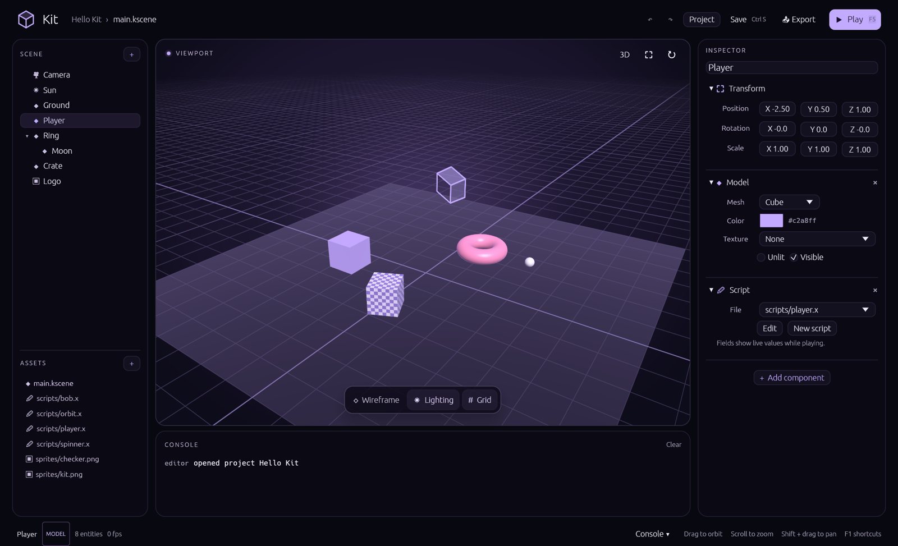

# Kit

**A modular 2D/3D game engine.** Kit is written in Rust, renders with Vulkan,
and stores scenes in an ECS with a scene graph. Gameplay is scripted in
[**x**](https://github.com/Caraveo/x). It comes with a native editor whose look
follows [Dimension](https://github.com/Caraveo/dimension).



**Documentation:** the [`documentation/`](documentation) folder is a Starlight site with guides for the editor, x scripting, physics and Canvas mode (`cd documentation && npm install && npm run dev`).

## Install

Download the latest build from [Releases](https://github.com/Caraveo/kit/releases):

| Platform | Package |
|---|---|
| Linux x86_64 / aarch64 | `.deb` (`sudo apt install ./kit_*.deb`) or portable `.tar.gz` |
| Windows x86_64 / arm64 | `.zip`; run `kit-editor.exe` |
| macOS Apple Silicon / Intel | `.dmg`; drag **Kit** to Applications. The build is unsigned, so on first launch right-click the app and choose **Open**. |

Kit needs a GPU with **Vulkan 1.3**. On macOS, Vulkan runs through MoltenVK, which
is bundled in the app.

## Quick start

1. Open **Kit** (`kit-editor`) and choose **Open example**, or **New project…**.
2. Select objects in the viewport or the scene list and edit them in the inspector.
3. Press **F5** to play. Click the viewport to send keyboard input to the game.
4. Attach scripts in the inspector (**Script → New script**) and edit them in the built-in x editor.
5. **Physics:** add a **Collider** (and a **Rigid Body** to make it fall, bounce and get pushed) from **Add component**.
6. **Canvas mode** (**D**, or ✏ Canvas in the dock): select an object and drag in the viewport to sketch a path. In play mode the object follows it as well as it can: colliders block it, it slides around obstacles, and physics bodies are steered by velocity. Shift + drag extends a path.
7. **Export** writes a folder with a runnable copy of your game.

A Kit project is a folder:

```
my-game/
├─ kit.project        # title, main scene, window settings (TOML)
├─ main.kscene        # scenes (JSON)
├─ scripts/player.x   # x scripts
└─ sprites/hero.png   # textures
```

Run a project without the editor: `kit-player my-game/`.

## Scripting with x

```x
TAKE Transform, Input

CREATE Player[
    FLOAT Speed: 3.0

    VOID CREATE Update(FLOAT dt)[
        FLOAT X: Input.Axis("Left", "Right")
        Transform.Move(X * Speed * dt, 0, 0)
    ]
]
```

See [docs/x.md](docs/x.md) for the language and the engine modules scripts can `TAKE`.

## Architecture

Kit's layout follows [Defold](https://github.com/defold/defold): each subsystem is a
**module** (its own crate) that registers its components, resources and systems
with the `App`.

| Module | Role |
|---|---|
| `kit_ecs` | entities, sparse-set components, resources, queries |
| `kit_core` | `App`, `Module` trait, stages, play/edit modes, time, console |
| `kit_scene` | transforms, parent/child hierarchy, propagation |
| `kit_input` | keyboard and mouse |
| `kit_resource` | project files and assets |
| `kit_gamesys` | Camera, Model, Sprite, Light and Script components; `.kscene` files |
| `kit_graphics` | Vulkan device, swapchain, memory, pipelines, WGSL to SPIR-V |
| `kit_render` | draws 3D models and 2D sprites, grid, picking |
| `kit_collider` | collision shapes, contact/trigger events, ray casts |
| `kit_physics` | rigid bodies: gravity, forces, bounces (Rapier) |
| `kit_path` | follows paths sketched in Canvas mode, around colliders |
| `kit_x` | the x language: lexer, parser, interpreter |
| `kit_script` | runs x scripts on entities |
| `kit_engine` | the windowed runtime |
| `kit` | one crate that re-exports every module |

Apps written in Rust can use the engine directly:

```rust
use kit::prelude::*;

fn main() -> anyhow::Result<()> {
    let mut app = App::new();
    kit::engine::add_default_modules(&mut app, ".".into(), &Default::default());
    let cam = spawn_node(&mut app.world, "Camera", Transform::from_xyz(0.0, 1.0, 5.0));
    app.world.insert(cam, Camera::perspective());
    let cube = spawn_node(&mut app.world, "Cube", Transform::IDENTITY);
    app.world.insert(cube, Model::default());
    run(app, EngineConfig::default())
}
```

## Building from source

```sh
# Linux: sudo apt install libvulkan-dev libxkbcommon-dev libwayland-dev
cargo run -p kit-editor --release            # the editor
cargo run -p kit-player -- examples/hello    # the player
cargo test --workspace
```

Set `KIT_VALIDATION=1` to enable the Vulkan validation layers. Packaging scripts
are in `packaging/`. Pushing a `v*` tag builds installers for every platform
through GitHub Actions.
