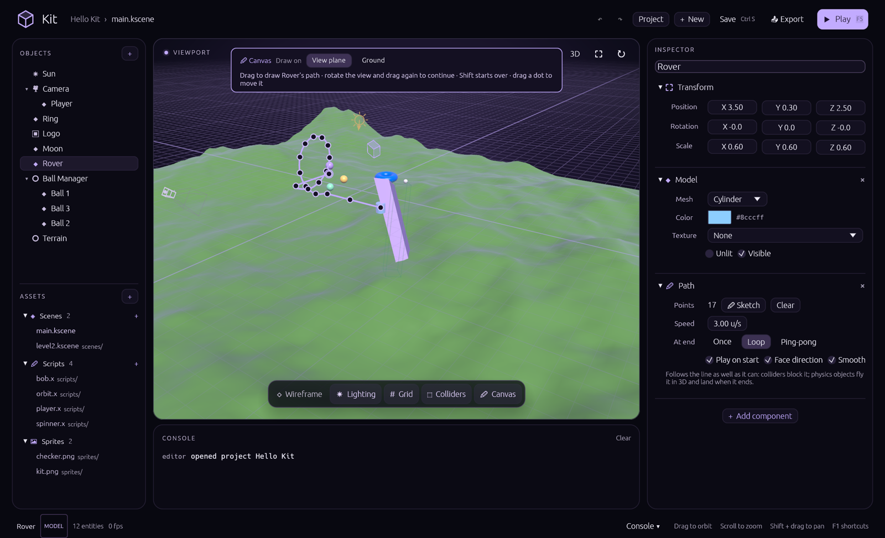

import { Steps, Aside } from '@astrojs/starlight/components';

Canvas mode lets you **draw movement** instead of programming it. Select an object and draw its path. In play mode it follows the path as well as it can.

## Drawing in 3D

You draw on a **flat sheet facing the camera**, like drawing on the screen. The sheet passes through the **end of the path**. Rotate the view and the sheet turns with it, so your next stroke heads off in a new direction. A few strokes from different angles make loops, climbs and dives.

<Steps>

1. Select the object.
2. Press <kbd>D</kbd> or click **✏ Canvas** in the dock. A banner appears at the top of the viewport.
3. **Drag** to draw. A faint grid shows the sheet you are drawing on.
4. **Rotate the view** (right-drag) and **drag again**. The path continues from where it ended.
5. Press <kbd>F5</kbd> to watch it move.

</Steps>

| In Canvas mode | |
|---|---|
| Drag | Draw. Each stroke continues the path from its end. |
| <kbd>Shift</kbd> + drag | Start over from the object. |
| Drag a **dot** | Move that point (on a sheet facing the camera, through the point). |
| Right drag | Orbit the camera. |
| <kbd>Ctrl</kbd> + <kbd>Z</kbd> | Undo the last stroke or point move. |
| <kbd>Esc</kbd> or <kbd>D</kbd> | Leave Canvas mode. |

### Ground mode

Choose **Draw on: Ground** in the banner to draw on the ground instead. On a [terrain](/editor/terrain/), the path follows hills and valleys at the object's height above the ground. Use this for characters and vehicles that walk or drive. **View plane** is the default.

## Following the path

Kit tries to stay on the line, but it respects the world around it:

- **Physics objects** (Dynamic) **fly** the path in full 3D. Gravity is suspended while they follow it. Collisions still block them and they still push other objects. When the path ends or pauses, gravity returns and the object falls and lands.
- **Objects with a collider** look ahead and **slide along** walls and other colliders instead of passing through them.
- **Plain objects** move along the line exactly.

If an object makes no progress for about a second (stuck behind something), it moves on to the next point.

## Path settings

The **Path** section in the inspector:

| Setting | |
|---|---|
| **Points** | **✏ Sketch** turns on Canvas mode; **Clear** removes the path. |
| **Speed** | Units per second. |
| **At end** | **Once** (stop), **Loop** (back to the start), or **Ping-pong** (back and forth). |
| **Play on start** | Start moving when the game starts. Turn it off to start from a script. |
| **Face direction** | Turn to face the direction of travel. |
| **Smooth** | Follow a smooth curve through the points (on by default) instead of straight segments. |

<Aside type="tip">
Control a path from a script with the `Path` module: `Path.Play()`, `Path.Pause()`, `Path.SetSpeed(6)`. See [Engine modules](/scripting/engine-modules/#path).
</Aside>

Paths are saved in the scene, so they ship with your game.
