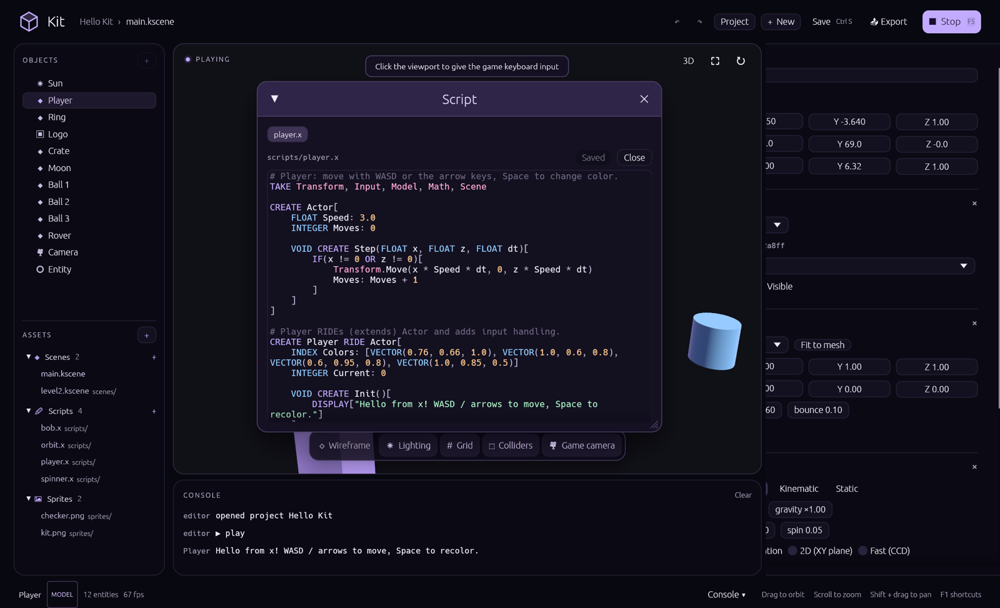

Press <kbd>F5</kbd> (or **▶ Play**) to run the game inside the viewport.

- **Click the viewport** to give the game the keyboard (its border lights up). Press <kbd>Esc</kbd> to give the keyboard back to the editor.
- The **Game camera** dock button switches between the game's camera and the free editor camera, so you can watch from any angle.
- Press <kbd>F5</kbd> again to stop. **Everything goes back to how it was before you pressed play.** Changes made while playing are thrown away.

## The console

`DISPLAY[...]` in a script prints to the console, labeled with the object's name. Errors appear in red with the file and line, for example:

```
scripts/player.x:12: `Speed` is not declared; declare it with a type first, e.g. `FLOAT Speed: 0.0`
```

A script that hits an error stops for the rest of the run, and the inspector's Script section says so. Fix the script, save it, and it reloads.

## Live values

While playing, select an object with a script: the **Script** section lists every field with its current value. Physics objects show their live **Velocity**.

## Hot reload

Saving a script while the game runs reloads it immediately. `Final()` runs on the old version and `Init()` on the new one. Textures reload the same way.
