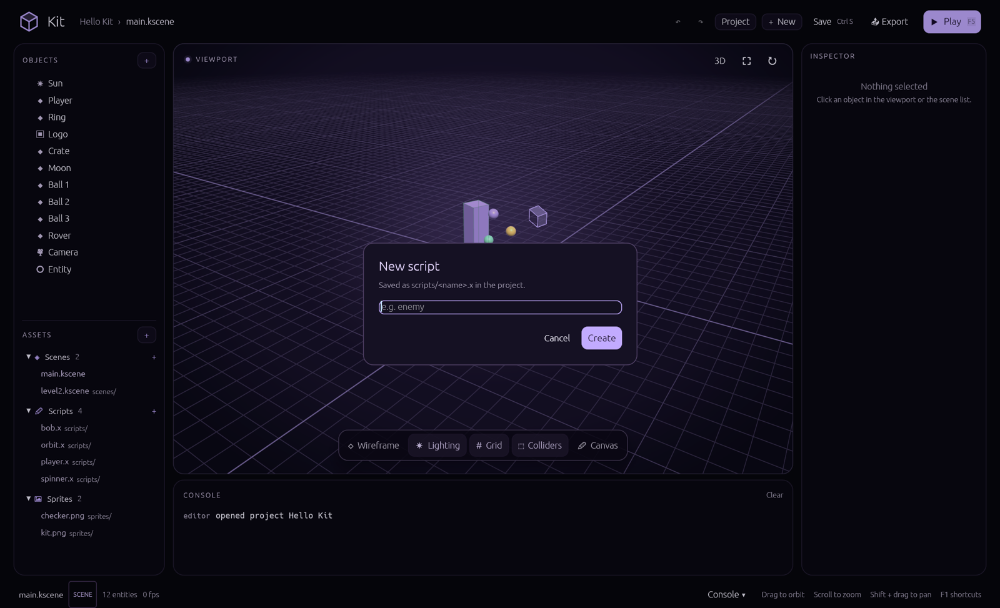

## Create a scene or script

Click **＋ New** in the header and choose **Scene…** or **Script…**, or use the **+** next to the **Scenes** or **Scripts** group in the asset list. A dialog asks for a name; press <kbd>Enter</kbd> or click **Create**.

- Scripts are saved as `scripts/<name>.x` and open in the code editor. The class inside is named after the file: `enemy_ai.x` contains `CREATE EnemyAi[`.
- Scenes are saved as `scenes/<name>.kscene` and become the current scene. If the old scene had unsaved changes, Kit saves them first.

Names are made file-safe: `Boss Fight` becomes `boss_fight`.

## The asset list

Kit groups files by extension:

| Group | Extensions | Used for |
|---|---|---|
| Scenes | `.kscene` | Levels and menus |
| Scripts | `.x` | Gameplay code |
| Sprites | `.png` `.jpg` `.jpeg` | Textures for sprites and models |
| Models | `.glb` `.gltf` `.obj` `.fbx` `.usdz` `.stl` | 3D models for scenes |
| Sounds | `.wav` `.ogg` `.mp3` `.flac` `.m4a` | Sound effects and music |
| Fonts | `.ttf` `.otf` | Listed now |
| Data | `.json` `.toml` `.csv` `.txt` | Your own data files |

Put files anywhere inside the project folder (subfolders are fine). The list refreshes on its own every couple of seconds.

### Renaming an asset

Right-click a file in the asset list and choose **Rename…**, or hover it and press <kbd>F2</kbd>. Type the new name and press <kbd>Enter</kbd>. The folder and extension stay the same.

Kit updates everything that uses the file:
- The open scene (including unsaved edits and the undo history) and every other scene.
- Diagrams.
- Quoted paths in x scripts, such as `"sounds/jump.wav"`.
- Open script tabs.
- The project's main scene.

A note says how many references were updated. Kit won't overwrite another file with the same name. Stop the game before renaming.

## Using 3D models

With a project open, drop an OBJ, GLB, glTF, FBX, USDZ, or STL file onto the Kit editor window, or select **Assets → + → Import 3D models…**. Kit lists the imported asset under **Assets → Models**. Double-click it to add it to the scene, or choose it from **Inspector → Model → Mesh** for an existing object.

Install Blender 4.5 or newer to import GLB, glTF, FBX, USDZ, STL, or OBJ files with an MTL material library. Kit looks on your PATH and in the standard macOS and Windows installation folders. You can also set `KIT_BLENDER` to the Blender executable. Keep external buffers, material libraries, and textures alongside their source model in the referenced locations. Kit bundles the resulting mesh, base-color textures, and clips in the project, so the editor and exported game can use the imported asset without Blender.

Converted models retain per-surface colors, base-color textures, transparency, and supported scalar surface settings. The Model inspector can tint the result or override its base-color texture. Arbitrary Blender shader graphs and additional texture channels such as normal maps are outside the current importer.

In **Model**, choose the **Clip**, set its **Speed**, and choose whether to **Loop**. The selected clip plays when you press **F5**. Uncheck **Animate in play mode** to keep the model in its imported pose. Animation is stored as sampled mesh poses, including evaluated skeletal and morph deformation.

## Rigging a character

Select a model and choose **Create rig** in the Inspector. Press <kbd>9</kbd> or choose **Rig** in the viewport dock to enter or leave Rig mode.

- In **Fit**, add sphere, capsule, and box volumes, or start with **Humanoid preset**. Select a volume in the viewport or hierarchy, then use the transform gizmos and Inspector to fit it to the character. Choose another volume under **Follow** to connect them. Moving a parent carries its children. In **Pose**, dragging a child can pull the connected chain with it. The joints keep their fitted length in **Pose** and during playback. Use **Fit** to change the length. **Weights** shows how strongly the volumes affect the mesh.
- In **Pose**, move or rotate the volumes to deform the mesh. **Select mesh** returns to the model’s Rig Inspector, where you can save and apply named poses.
- Open **Animation**, name a clip, and add it. Scrub to a time, pose the character, and click **Key**. Select the clip under **Play on start** in the Rig Inspector to play it in the game.

Rigs, poses, and clips are saved in the scene and travel with native and web exports. An enabled volume rig drives its own deformation from the model’s rest mesh. Existing model bundles without a dedicated rest frame use their first baked frame, so reimport the original if that frame is already posed.

## Using images

Select a sprite or model, then click an image in **Sprites**. It becomes the object's texture. You can also pick a texture in the inspector's **Texture** box.

Edit an image in any paint program and save it: Kit reloads it automatically, even while playing.

## Switching scenes

Click a scene in the asset list to open it. To change which scene the game starts with, use **Project → Project settings → Main scene**.
