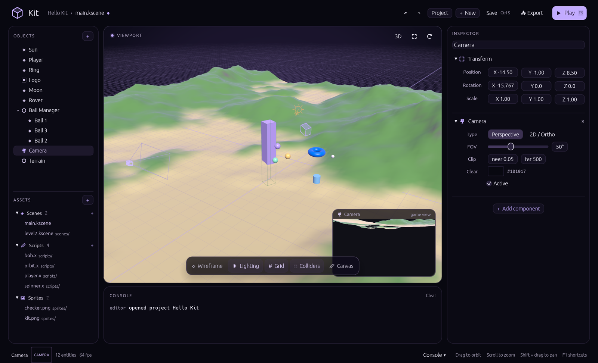

## Add a terrain

Click **＋ New → Object → Terrain**. Kit creates a 64 × 64 unit terrain with randomly generated hills. You can also add a **⛰ Terrain** component to any object.

Kit colors the terrain automatically:
- **grass** on flat ground;
- **rock** on steep slopes;
- **snow** on high peaks;
- **sand** in hollows dug below the sand line.

## Sculpt

Select the terrain. In the inspector's **Terrain → Sculpt** row, pick a tool, then **drag on the terrain** in the viewport:

| Tool | Effect |
|---|---|
| **Raise** / **Lower** | Build up or dig out ground. Hold <kbd>Ctrl</kbd> to do the opposite. |
| **Smooth** | Soften bumps and edges. |
| **Flatten** | Level the ground to the height where the stroke started. Good for building sites and roads. |

**Brush size** and **strength** sit below the tools. A circle on the ground shows where the brush will act. Right-drag orbits the camera while sculpting. Pick **Off** to go back to normal selection.

Each stroke is one step in undo (<kbd>Ctrl</kbd> + <kbd>Z</kbd>).

## Shape and generation

| Setting | |
|---|---|
| **Size** | Width and depth in world units. The object's Scale stretches it as well. |
| **Resolution** | Height samples per side: 33, 65, 129 or 257. Changing it keeps the current shape. |
| **Generate** | **Seed**, **height** and **rough** (how bumpy), then **⛰ Generate hills**. **🎲** tries a new seed. **Flatten** resets everything to 0. |
| **Colors** | Sand, grass, rock and snow colors, plus the sand and snow **levels**. |
| **Collider** | On by default. Physics objects stand on and roll down the terrain. |

## Terrain and other features

- **Physics:** dynamic bodies land on the terrain, slide and roll down slopes. The terrain uses a heightfield collider.
- **Canvas mode:** a path sketched over a terrain follows the ground, keeping the object's height above it.
- **Scripts:** `TAKE Terrain`, then `Terrain.HeightAt(x, z)` gives the ground height at a point (or `NULL` off the terrain):

```x
TAKE Transform, Terrain
VOID CREATE Update(FLOAT dt)[
    ANY H: Terrain.HeightAt(Transform.Position.X, Transform.Position.Z)
    IF(EXIST H)[
        Transform.Position: VECTOR(Transform.Position.X, H + 0.5, Transform.Position.Z)
    ]
]
```
