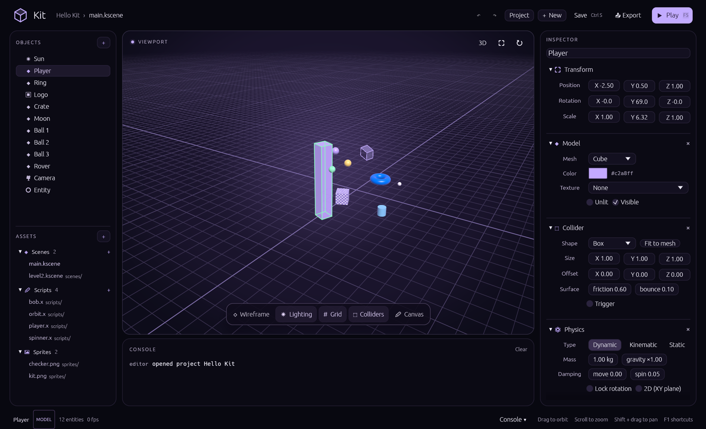

## Header

- **Kit › project › scene**: what you are editing. A **●** dot means the scene has unsaved changes.
- **↶ ↷**: undo and redo (<kbd>Ctrl</kbd> + <kbd>Z</kbd>, <kbd>Ctrl</kbd> + <kbd>Shift</kbd> + <kbd>Z</kbd>).
- **Project**: new project, open project, open the example, **Project settings…**, and recent projects.
- **＋ New**: a new **Scene…**, **Script…** or **Object**.
- **Save** (<kbd>Ctrl</kbd> + <kbd>S</kbd>) and **Export** (a runnable copy of your game).
- **▶ Play / ■ Stop** (<kbd>F5</kbd>).

## Objects (left)

Every object in the scene, as a tree.

- **Click** an object to select it. The view glides over and zooms to fit the object (and its children), whatever its size.
- **Double-click** it, or press <kbd>F2</kbd>, to rename it. <kbd>Enter</kbd> or clicking elsewhere saves the name; <kbd>Esc</kbd> cancels.
- **Drag** an object onto another to make it a child. Drop it on the upper or lower edge of a row to reorder instead, or on empty space to move it back to the top level.
- **Right-click** an object for Frame, Add child, Rename, Duplicate and Delete.
- The **+** button adds an object.

## Assets (left, below)

Files in your project, grouped by type: **Scenes, Scripts, Sprites, Models, Audio, Fonts, Data**.

- Click a scene to open it, or a script to edit it.
- Click an image while a sprite or model is selected to use it as that object's texture.
- The **+** on the Scenes and Scripts groups creates a new one.

## Viewport (center)

Your scene, rendered live with Vulkan.

| Action | Mouse |
|---|---|
| Orbit | Left drag |
| Pan | <kbd>Shift</kbd> + drag, right drag, or middle drag |
| Zoom | Scroll |
| Select | Click an object |
| Frame the object | Double-click, or <kbd>F</kbd> |

**Cameras and lights** appear in the viewport as gizmos: a camera shows its viewing frustum and a light shows a sun with its direction. Click them to select them. **Selecting a camera opens a preview** of exactly what it sees, in the bottom-right corner of the viewport.

Top right: **3D/2D** view (<kbd>T</kbd>), **⛶** frame selection, **↻** auto-rotate (<kbd>R</kbd>).

**The dock** (bottom of the viewport) toggles **Wireframe** (<kbd>W</kbd>), **Lighting** (<kbd>L</kbd>), **Grid** (<kbd>G</kbd>), **Colliders** (<kbd>C</kbd>, collider outlines) and **Canvas** (<kbd>D</kbd>, [sketch paths](/editor/canvas-mode/)). While playing, **Game camera** switches between the game's camera and the editor camera.

## Inspector (right)

Shows the selected object's name and components. Edit any value by dragging the number or clicking and typing. **＋ Add component** adds more. See [Objects & components](/editor/objects-and-components/).

## Console (bottom)

Shows script output (`DISPLAY[...]`) and any errors, with file and line. Toggle it with <kbd>`</kbd> or the **Console** button in the footer.

## Footer

The selected object and its type, the number of objects, the frame rate, and mouse hints. Press <kbd>F1</kbd> for all shortcuts.
