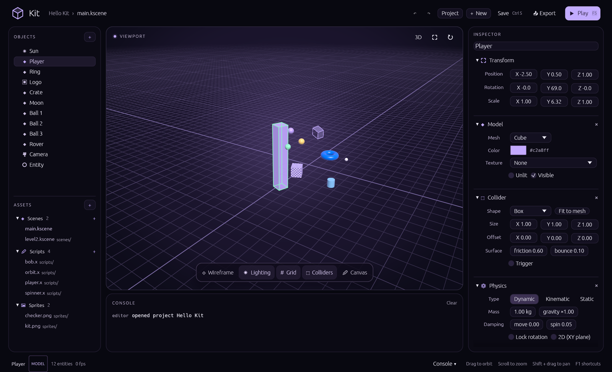

import { Card, CardGrid } from '@astrojs/starlight/components';

<CardGrid stagger>
	<Card title="A native editor" icon="laptop">
		Build scenes visually: objects, components, a live Vulkan viewport, undo, play mode and a code editor.
		[Take the tour](/editor/tour/).
	</Card>
	<Card title="Scripting with x" icon="pencil">
		A readable, C-like language with ALL-CAPS types, classes and methods.
		[Learn x](/scripting/basics/).
	</Card>
	<Card title="Physics" icon="rocket">
		Colliders, triggers, rigid bodies, gravity and ray casts, powered by Rapier.
		[Add physics](/physics/colliders/).
	</Card>
	<Card title="Canvas mode" icon="seti:image">
		Select an object and sketch a line. In play mode it follows the line and works its way around obstacles.
		[Sketch movement](/editor/canvas-mode/).
	</Card>
	<Card title="Modular" icon="puzzle">
		Every subsystem is a module (rendering, input, scripting, physics), modeled on Defold's architecture.
		[How it fits together](/engine/architecture/).
	</Card>
	<Card title="Ships everywhere" icon="download">
		Linux, Windows and macOS. Export your game as a folder anyone can run.
		[Export a game](/editor/export/).
	</Card>
</CardGrid>
