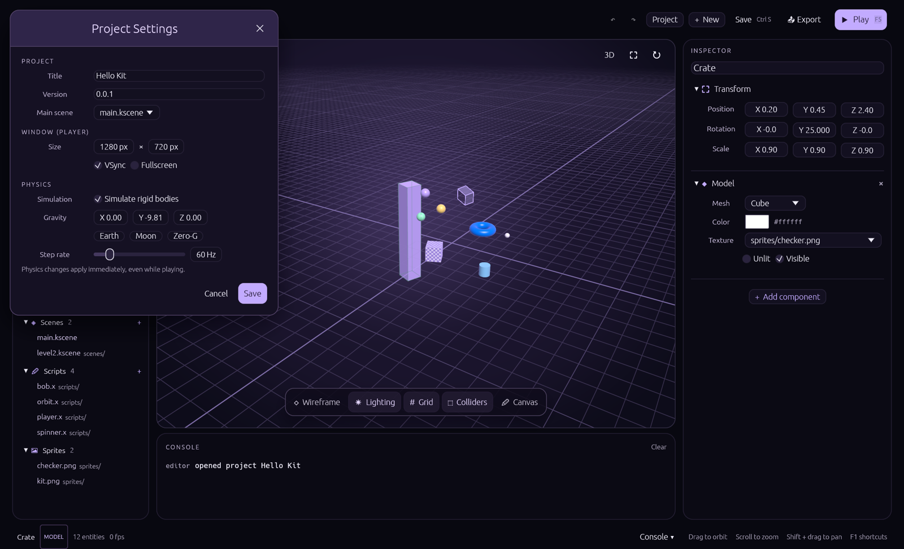

A **Collider** gives an object a physical shape. With colliders, objects:

- **Detect touches.** Scripts get `OnCollision` / `OnCollisionEnd`.
- **Block** moving objects. Physics bodies bounce off them, and [paths](/editor/canvas-mode/) slide around them.
- **Work as triggers.** A trigger detects overlaps (`OnTrigger`) without blocking anything.
- **Can be found with ray casts** (`Physics.Raycast`).

Add one with **＋ Add component → ⬚ Collider only**. Kit fits it to the object's mesh.

A collider **without** [Physics](/physics/physics-bodies/) follows its object: when a script moves the object, the collider moves with it and pushes physics bodies out of the way. Use this for level geometry, moving platforms and script-driven players.

## Settings

| Setting | |
|---|---|
| **Shape** | **Box** (size), **Sphere** (radius), **Capsule** (height, radius: good for characters), **Cylinder** (height, radius). **Fit to mesh** matches the model. |
| **Offset** | Moves the shape relative to the object. |
| **Friction** | How grippy the surface is (0 = ice). |
| **Bounce** | Restitution: 0 = no bounce, 1 = perfectly bouncy. |
| **Trigger** | Reports overlaps but doesn't block. |

Shapes scale with the object's **Scale**.

## Seeing colliders

The **Colliders** dock button (<kbd>C</kbd>) draws every collider's outline in the viewport: green for solid colliders, amber for triggers. The selected object's collider is always shown brighter.

